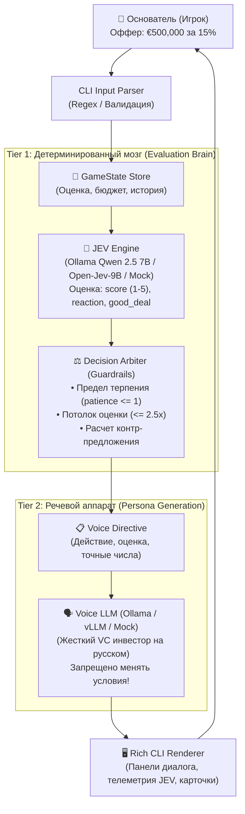
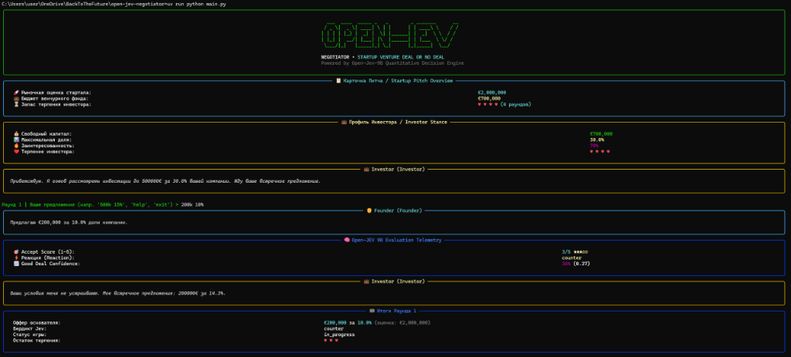
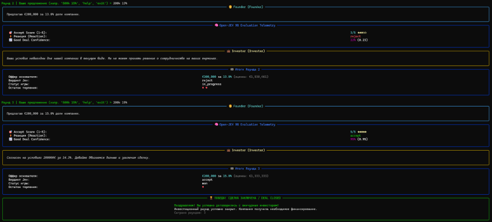

# 💼 Open-JEV Negotiator

> **CLI-игра «Переговоры со стартап-инвестором» (Startup Venture Deal or No Deal)**  
> Инновационная пошаговая игра с двухконтурным искусственным интеллектом (Quantitative Open-JEV Brain + Voice LLM Persona + Deterministic Guardrails).

[](https://www.python.org/downloads/)
[](https://github.com/astral-sh/uv)
[](https://docs.pydantic.dev/)
[](https://github.com/Textualize/rich)
[]()
[](REPORT.md)

---

> 🚀 **Полный отчет о проекте и бенчмарках:** Ознакомьтесь с [**REPORT.md**](REPORT.md) — детальный разбор реальной победной сессии с локальными моделями Open-Jev-2B и Ollama Qwen 2.5 7B, замеры задержки инференса (~490 мс) и каталог guardrails.

---

## 📖 Содержание / Table of Contents
- [1. Концепция и Архитектура / Concept & Architecture](#1-концепция-и-архитектура--concept--architecture)
- [2. Демонстрация игрового процесса / Gameplay Demo](#2-демонстрация-игрового-процесса--gameplay-demo)
- [3. Быстрый старт / Quickstart](#3-быстрый-старт--quickstart)
- [4. Подключение реальных моделей / Real Models Guide](#4-подключение-реальных-моделей--real-models-guide)
- [5. Правила игры и синтаксис / Game Rules & Syntax](#5-правила-игры-и-синтаксис--game-rules--syntax)
- [6. Запуск тестов / Running Tests](#6-запуск-тестов--running-tests)
- [7. Структура проекта / Project Structure](#7-структура-проекта--project-structure)
- [8. English Summary](#8-english-summary)
- [📊 Итоговый отчет проекта / Full Report (REPORT.md)](REPORT.md)

---

## 1. Концепция и Архитектура / Concept & Architecture

В традиционных LLM-играх языковые модели страдают от **галлюцинаций согласия**: даже получив указание «отказать», модель под влиянием учтивости может сказать «Ваше предложение интересное, давайте заключим сделку».

**Open-JEV Negotiator** решает эту проблему через **двухконтурную архитектуру (Two-tier Orchestration)** с детерминированным арбитражем:



### Ключевые компоненты:
1. **Tier 1: Open-JEV Evaluation Engine (`engine/jev_evaluator.py`)**  
   Оценивает формализованное состояние сделки по трем дискретным осям:
   - `accept` (`score`, 1–5): интегральная готовность принять предложение.
   - `reaction` (`choice`): дискретное решение (`accept`, `counter`, `reject`, `walk_away`).
   - `good_deal` (`noul`, 0.0–1.0): вероятность финансовой привлекательности сделки.
   Поддерживает бэкенды: **Ollama** (локальный Qwen 2.5 7B с генерацией строгого JSON), **HTTP** (официальный `jev.server` Open-Jev-9B) и **Mock** (детерминированный оффлайн-эмулятор для тестов).

2. **Deterministic Decision Arbiter & Guardrails (`engine/arbiter.py`)**  
   Абсолютный барьер безопасности бизнес-логики:
   - При `patience <= 1` и отсутствии согласия принудительно вызывает `walk_away`.
   - При завышении оценки $\ge 2.5 \times$ или превышении бюджета фонда принудительно блокирует сделку.
   - Вычисляет математически обоснованное встречное предложение инвестора.

3. **Tier 2: Voice LLM Persona (`engine/voice_llm.py`)**  
   Генерирует художественную реплику жесткого венчурного партнера на русском языке, строго подчиняясь директиве арбитра. Модель защищена пост-валидатором `validate_dialogue_guardrails`.

4. **Rich Terminal Presentation (`game/cli_renderer.py`)**  
   Интерактивный терминальный интерфейс с индикаторами терпения (`♥ ♥ ♥`), подробной телеметрией JEV и стилизованными карточками раундов.

---

## 2. Демонстрация игрового процесса / Gameplay Demo

Ниже представлены скриншоты реальной интерактивной партии переговоров в терминале с подключенными локальными моделями **Open-Jev-2B** (GPU CUDA) и **Ollama Qwen 2.5 7B**:

| Раунд 1: Первый оффер фаундера и контр-оффер инвестора | Раунд 3: Согласие инвестора и победное закрытие сделки |
| :---: | :---: |
|  |  |

> 📌 **Подробный разбор партии, бенчмарки и архитектура:**  
> Ознакомьтесь с [**Итоговым отчетом проекта (REPORT.md)**](REPORT.md) — подробный разбор ходов, замеры времени инференса Open-Jev-2B (~490 мс) и каталог защитных механизмов (Guardrails).

---

## 3. Быстрый старт / Quickstart

### 3.1 Запуск с реальным локальным ИИ (Ollama + Qwen 2.5 7B)
Если у вас запущен [Ollama](https://ollama.ai/) с моделью `qwen2.5:7b`:
```bash
# Интерактивная игра с реальным ИИ
uv run python main.py

# Или автоматическая симуляция сделки
uv run python main.py --test-run
```

### 3.2 Запуск в автономном Mock-режиме (без внешних API)
Для мгновенного тестирования логики без видеокарты:
```bash
uv run python main.py --mock
```

### 3.3 Настройка параметров переговоров через аргументы CLI
```bash
# Инвестор с увеличенным бюджетом и строгим терпением
uv run python main.py --valuation 3000000 --budget 900000 --patience 3
```

Флаги CLI:
| Флаг | Описание | Значение по умолчанию |
|---|---|---|
| `--backend` | Бэкенд оценщика: `ollama`, `http` (Open-Jev), или `mock` | `ollama` |
| `--model` | Название модели в Ollama | `qwen2.5:7b` |
| `--mock` | Принудительный оффлайн-режим (эмуляция без LLM) | `False` |
| `--test-run` | Неинтерактивная симуляция сделки | `False` |
| `--valuation` | Рыночная оценка вашего стартапа в € | `2,000,000` |
| `--budget` | Доступный капитал венчурного фонда в € | `700,000` |
| `--patience` / `--rounds` | Количество раундов терпения до ухода инвестора | `4` |
| `--llm-url` | URL эндпоинта Voice LLM (Ollama, vLLM, OpenAI API) | `http://localhost:11434/v1` |
| `--jev-url` | URL сервиса инференса Open-Jev-9B | `http://127.0.0.1:8791/v1/systemone` |

---

## 4. Подключение реальных моделей / Real Models Guide

Для работы с реальными нейросетями настройте файл окружения `.env`.

### 4.1 Конфигурация `.env`
Создайте файл `.env` в корне проекта (по шаблону):
```env
# Режим работы (False для подключения к реальным сервисам)
MOCK_MODE=False
JEV_BACKEND=ollama

# Voice LLM & Evaluator (Ollama)
LLM_URL=http://localhost:11434/v1
LLM_API_KEY=dummy
LLM_MODEL=qwen2.5:7b
OLLAMA_URL=http://localhost:11434

# Open-JEV-9B HTTP Сервис (при запуске через python -m jev.server)
JEV_URL=http://127.0.0.1:8791/v1/systemone
JEV_MODEL_PATH=ZefanCai/Open-Jev-9B

# Параметры игры по умолчанию
DEFAULT_COMPANY_VALUATION=2000000
DEFAULT_INVESTOR_BUDGET=700000
DEFAULT_INVESTOR_MAX_EQUITY=30.0
DEFAULT_INVESTOR_INTEREST=0.70
DEFAULT_INVESTOR_PATIENCE=4
```

### 4.2 Запуск через локальный Ollama (Рекомендуется)
1. Установите [Ollama](https://ollama.ai/) и загрузите модель:
   ```bash
   ollama pull qwen2.5:7b
   ```
2. Запустите игру — она автоматически использует Ollama и для оценки условий, и для речи инвестора:
   ```bash
   uv run python main.py
   ```

### 4.3 Запуск через официальный Open-Jev сервер
Если вы используете официальный сервер из репозитория [Zefan-Cai/Open-Jev](https://github.com/Zefan-Cai/Open-Jev):
```bash
python -m jev.server --checkpoint ./checkpoints/open-jev-9b/package/checkpoint --port 8791
```
И запустите игру с флагом бэкенда:
```bash
uv run python main.py --backend http --jev-url http://127.0.0.1:8791/v1/systemone
```

---

## 5. Правила игры и синтаксис / Game Rules & Syntax

### 5.1 Математика сделки
- **Имплицитная оценка компании (Implied Valuation):**
  $$\text{Implied Valuation} = \frac{\text{Investment}}{\text{Equity} / 100}$$
- **Коэффициент оценки ($\rho$):**
  $$\rho = \frac{\text{Implied Valuation}}{\text{Company Valuation}}$$
  - $\rho \le 0.75$: Высокая выгода для инвестора — высокая вероятность согласия (`accept`).
  - $0.75 < \rho \le 1.15$: Справедливая рыночная зона — инвестор торгуется (`counter`).
  - $1.15 < \rho \le 2.50$: Завышенная оценка — риск отказа (`reject`).
  - $\rho > 2.50$ или $\text{Investment} > \text{Budget}$: Хищническое предложение — немедленный срыв переговоров (`walk_away`).

### 5.2 Поддерживаемые форматы ввода
CLI-парсер распознает естественный язык, сокращения и валюты:
- `500k 10%` — €500,000 за 10%
- `500000 15` — прямой числовой ввод (€500,000 за 15%)
- `€400,000 for 12.5%` — международный формат
- `1.2m 20%` — обозначение миллионов (€1,200,000 за 20%)
- `300к за 15%` — русскоязычный формат с предлогом
- `450k for 18%` — с англоязычным предлогом
- `250 тыс за 10%` / `1.5 млн 20%` — текстовые множители

### 5.3 Команды управления
- `help` / `?` — показать справку по правилам и синтаксису.
- `status` — повторно вывести карточку стартапа и профиль инвестора.
- `history` — показать хронологию всех ходов текущей сессии.
- `exit` / `quit` / `give up` — сдаться и прервать переговоры.

---

## 6. Запуск тестов / Running Tests

Проект разработан по строгой методологии **Test-Driven Development (TDD)** с полным покрытием контрактов, логики арбитража, адаптеров моделей, UI и CLI-парсера.

```bash
# Запуск полного тестового набора
uv run pytest

# Подробный вывод со всеми тестовыми кейсами
uv run pytest -v

# Проверка конкретного модуля (например, CLI и парсера)
uv run pytest tests/test_main.py -v
```

Текущее состояние: **237 passed** (0 failures, 0 regressions).

---

## 7. Структура проекта / Project Structure

```text
open-jev-negotiator/
├── config.py                 # Pydantic Settings & параметры окружения (.env)
├── schemas.py                # Pydantic v2 контракты (GameState, JevResult, VoiceDirective)
├── engine/
│   ├── arbiter.py            # Детерминированный арбитр: guardrails и контр-офферы
│   ├── jev_evaluator.py      # Адаптер Open-JEV (Mock и HTTP REST клиенты)
│   └── voice_llm.py          # Адаптер Voice LLM (генератор русской речи персонажа)
├── game/
│   ├── session.py            # Координатор игровой сессии и машины состояний
│   └── cli_renderer.py       # Rich UI рендерер (баннеры, панели, сердечки терпения)
├── docs/
│   └── screenshots/          # Скриншоты реального геймплея для отчета и README
├── tests/
│   ├── conftest.py           # Pytest фикстуры
│   ├── test_schemas.py       # Тесты контрактов и валидации данных
│   ├── test_arbiter.py       # Тесты guardrails и арбитража
│   ├── test_jev_evaluator.py # Тесты количественного скоринга Jev
│   ├── test_voice_llm.py     # Тесты речевого LLM и фильтра безопасности
│   ├── test_session.py       # Интеграционные тесты конечного автомата
│   ├── test_cli_renderer.py  # Тесты визуализации в консоли
│   └── test_main.py          # Тесты CLI парсера, аргументов и E2E сценариев
├── main.py                   # Точка входа: REPL цикл и неинтерактивная симуляция
├── pyproject.toml            # Описание проекта и зависимостей uv
├── README.md                 # Главная документация проекта
└── REPORT.md                 # Полный отчет проекта с разбором сессии и бенчмарками
```

---

## 8. English Summary

**Open-JEV Negotiator** is a CLI negotiation game showcasing a **two-tier AI architecture**:
1. **Tier 1 (Quantitative Evaluation Brain):** Open-JEV-9B reasoning model evaluates game state along discrete axes (`accept_score`, discrete `reaction`, `good_deal` confidence).
2. **Deterministic Decision Arbiter:** Physical and financial guardrails enforce mathematical bounds, calculate counter-offers, and terminate negotiations when patience expires, completely preventing LLM hallucination of false agreements.
3. **Tier 2 (Voice LLM Dialogue):** Local or remote LLM (via Ollama/vLLM) generates authentic Russian venture capitalist dialogue adhering strictly to arbiter directives.
4. **Rich Terminal UI:** Polished interactive terminal interface with patience hearts, evaluation telemetry, and pitch cards.

### Quick Run:
```bash
uv sync
uv run python main.py --mock
```
