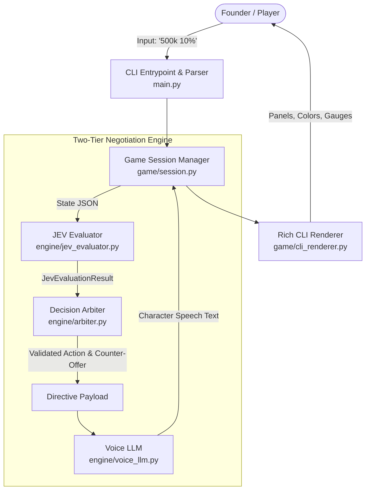
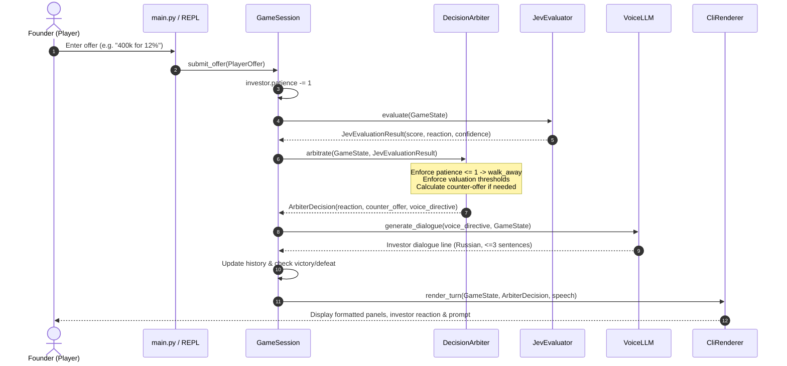

# Architectural Implementation Plan: Open-JEV Negotiator

**Product:** CLI-игра «Переговоры со стартап-инвестором» (Jev + LLM Orchestration)  
**Specification Reference:** [`spec.md`](../spec.md)  
**Status:** In Planning  
**Target Platform:** Python 3.11+ (cross-platform, Windows/Linux/macOS) via `uv`

---

## 1. System Overview & Core Philosophy

The Open-JEV Negotiator is a terminal-based turn-based negotiation game where a startup founder pitches an NPC venture capitalist. 

The core architectural innovation is a **Two-Tier AI Architecture (Двухконтурный ИИ)**:

1. **Deterministic Brain (Evaluation Engine):**
   - Implemented via the **Open-Jev-9B** paradigm (or compatible REST/Mock runtime).
   - Responsible strictly for quantitative assessment:
     - `accept` (`score` 1–5): Overall deal acceptability score.
     - `reaction` (`choice`): Discrete action (`accept`, `counter`, `reject`, `walk_away`).
     - `good_deal` (`noul`): Binary probability confidence (0.0..1.0) whether the deal is advantageous to the investor.
   - **Crucial Rule:** The evaluation engine evaluates raw game state numbers without conversational prose.

2. **Deterministic Arbiter (Guardrail Boundary):**
   - Sandwiched between evaluation and speech generation.
   - Enforces hard physical and business constraints:
     - If investor patience reaches $\le 1$ or valuation exceeds absurd thresholds, reaction is hard-locked to `walk_away`.
     - Calculates deterministic counter-offers based on remaining budget and interest coefficients.
     - Prevents model hallucinations from breaking game balance.

3. **Vocal Apparatus (Dialogue Generation):**
   - An LLM (Ollama / vLLM / OpenAI-compatible endpoint, or high-fidelity mock).
   - **Strict Subordination:** The Voice LLM does *not* make business decisions. It receives an immutable `Directive` and converts it into up to 3 sentences of Russian venture-capitalist speech.
   - Has zero authority to accept when the directive is `reject`, or propose numbers differing from the Arbiter's counter-offer.

---

## 2. Architecture & Data Flow

### 2.1 Component Interaction Diagram



### 2.2 Sequence Diagram of a Single Negotiation Turn



---

## 3. Component Design & Specifications

### 3.1 Project Structure

```text
open-jev-negotiator/
├── pyproject.toml            # Project metadata & dependencies (uv managed)
├── README.md                 # Project documentation & run guide
├── config.py                 # Pydantic Settings (.env, LLM/Jev endpoints, defaults)
├── schemas.py                # Core Pydantic schemas (contracts)
├── engine/
│   ├── __init__.py
│   ├── arbiter.py            # Guardrails, counter-offer logic, directive builder
│   ├── jev_evaluator.py      # Open-Jev-9B client + MockEvaluator
│   └── voice_llm.py          # Voice LLM client + MockVoiceLLM + Prompt Guardrails
├── game/
│   ├── __init__.py
│   ├── session.py            # Game state machine, round history, win/loss
│   └── cli_renderer.py       # Rich UI terminal presentation
├── main.py                   # CLI entry point, argument parsing, REPL
└── tests/
    ├── conftest.py           # Shared fixtures & test helpers
    ├── test_schemas.py       # Validation tests for schemas
    ├── test_arbiter.py       # Unit tests for guardrails & math
    ├── test_jev_evaluator.py # Unit tests for Jev client & mock
    ├── test_voice_llm.py     # Prompt & voice dialogue tests
    ├── test_session.py       # Session lifecycle & state machine tests
    ├── test_cli_renderer.py  # Rich UI rendering tests
    └── test_main.py          # CLI parser & integration tests
```

---

### 3.2 Component Details

#### 3.2.1 Configuration (`config.py`)
- Based on `pydantic-settings.BaseSettings`.
- Supported settings:
  - `MOCK_MODE: bool = False` (auto-enabled when endpoints are unreachable or via `--mock` flag).
  - `LLM_URL: str = "http://localhost:11434/v1"` (OpenAI-compatible / Ollama / vLLM).
  - `LLM_API_KEY: str = "ollama"`
  - `LLM_MODEL: str = "llama3:8b"`
  - `JEV_URL: str | None = None`
  - `JEV_MODEL_PATH: str = "ZefanCai/Open-Jev-9B"`
  - Default game parameters:
    - `DEFAULT_COMPANY_VALUATION: int = 2_000_000`
    - `DEFAULT_INVESTOR_BUDGET: int = 700_000`
    - `DEFAULT_INVESTOR_MAX_EQUITY: float = 30.0`
    - `DEFAULT_INVESTOR_INTEREST: float = 0.70`
    - `DEFAULT_INVESTOR_PATIENCE: int = 4`

#### 3.2.2 Data Contracts (`schemas.py`)
- **`PlayerOffer`**:
  - `investment: int` (> 0)
  - `equity: float` (> 0 and <= 100)
  - Computed property `implied_valuation`: `investment / (equity / 100)`
- **`InvestorState`**:
  - `budget: int` (> 0)
  - `max_equity: float` (> 0 and <= 100)
  - `interest: float` (0.0 to 1.0)
  - `patience: int` (>= 0)
- **`GameState`**:
  - `company_valuation: int` (> 0)
  - `player_offer: PlayerOffer`
  - `investor: InvestorState`
  - `history: list[str]`
  - Method `to_jev_payload() -> dict`: Serializes raw data into standard JSON as mandated by spec section 4.1.
- **`JevQueryConfig`**, **`JevEvaluationSchema`**, **`JevEvaluationResult`**:
  - Strict compliance with spec 3.2 (`accept_score` 1..5, `reaction` Literal, `good_deal_confidence` 0..1).
- **`VoiceDirective`**:
  - `reaction: Literal["accept", "counter", "reject", "walk_away"]`
  - `accept_score: int` (1..5)
  - `good_deal_status: str` ("Выгодно" / "Невыгодно" / "Сомнительно")
  - `counter_offer_investment: int | None`
  - `counter_offer_equity: float | None`
- **`RoundResult` & `GameStatus`**:
  - Track per-round outcome, timestamps, and terminal state (`in_progress`, `won`, `lost`, `quit`).

#### 3.2.3 Decision Arbiter (`engine/arbiter.py`)
- **Patience Guardrail:** If `investor.patience <= 1` and current round reaction is not `accept`, force `walk_away`.
- **Valuation Guardrail:** If player's `implied_valuation` is $\ge 2.5 \times company\_valuation$ or `investment > investor.budget`, force `walk_away` or `reject`.
- **Counter-offer Generation:**
  - When reaction is `counter`, compute realistic, advantageous terms for the investor:
    - Investment: $\min(\text{offer.investment}, \text{investor.budget})$.
    - Equity: Adjusted according to investor's valuation expectation:
      $$\text{target\_equity} = \min\left(\text{investor.max\_equity}, \max\left(\text{offer.equity} \times 1.25, \frac{\text{investment}}{\text{company\_valuation} \times \text{investor.interest}} \times 100\right)\right)$$
    - Round equity to 1 decimal place, investment to nearest thousands.
- **Directive Builder:** Formats `VoiceDirective` ensuring consistency.

#### 3.2.4 Open-JEV Evaluator (`engine/jev_evaluator.py`)
- **`BaseJevEvaluator`** (Protocol / Abstract Base Class).
- **`MockJevEvaluator`**:
  - Fully offline, reproducible scoring model.
  - Implied valuation ratio: $\rho = \frac{\text{implied\_valuation}}{\text{company\_valuation}}$.
  - Logic:
    - If $\rho \le 1.1$ and `equity <= investor.max_equity` and `investment <= investor.budget`:
      Score 4 or 5, `accept`, confidence 0.85+.
    - If $1.1 < \rho \le 1.6$:
      Score 3, `counter`, confidence 0.50..0.75.
    - If $1.6 < \rho \le 2.2$:
      Score 2, `reject` or `counter`, confidence 0.25..0.45.
    - If $\rho > 2.2$ or `investment > budget`:
      Score 1, `walk_away` or `reject`, confidence 0.05..0.20.
- **`HttpJevEvaluator`**:
  - Makes asynchronous HTTP POST via `httpx` with timeout and error handling.
  - Falls back gracefully to `MockJevEvaluator` if unreachable and warning logged.

#### 3.2.5 Voice LLM (`engine/voice_llm.py`)
- **System Prompt:** Verbatim prompt from spec section 5:
  ```text
  Ты — жесткий, прагматичный венчурный инвестор. Твоя задача — озвучить решение, которое УЖЕ ПРИНЯТО аналитическим отделом.
  Ты не имеешь права соглашаться, если решение REJECT или COUNTER.
  Ты не имеешь права предлагать другие суммы и проценты, кроме указанных в директиве.

  ДИРЕКТИВА:
  - Действие: {reaction}
  - Готовность принять сделку: {accept_score}/5
  - Выгодность предложения: {good_deal_status}
  - Встречные условия (если action=counter): {counter_offer_investment}€ за {counter_offer_equity}%

  Сгенерируй только прямую речь персонажа на русском языке (до 3 предложений). Не добавляй вводных слов автора.
  ```
- **`MockVoiceLLM`**:
  - Rich variety of pre-scripted high-conviction Russian dialogue templates for each reaction type.
  - Formats counter-offer numbers dynamically.
- **`HttpVoiceLLM`**:
  - Talks to Ollama / vLLM / OpenAI chat completions API.
  - **Post-Generation Safety Filter:** Scans output to detect semantic inversions (e.g., words like "согласен", "по рукам", "договорились" when action is `reject` or `walk_away`). If violated, replaces with fallback authorized line.

#### 3.2.6 Game Session (`game/session.py`)
- Coordinates rounds:
  1. Receives player offer.
  2. Updates patience and history.
  3. Queries Jev evaluator.
  4. Runs Arbiter guardrails.
  5. Queries Voice LLM.
  6. Checks win/loss criteria:
     - Win: `reaction == "accept"`
     - Loss: `reaction == "walk_away"` or `patience == 0`
     - Ongoing: `reaction in ("counter", "reject")` and `patience > 0`
  7. Records turn in history.

#### 3.2.7 CLI Renderer (`game/cli_renderer.py`)
- Built with `rich`:
  - `render_header()`: Stylized ASCII logo and game banner.
  - `render_pitch_card()`: Startup valuation, round limit, initial VC stance.
  - `render_investor_status()`: Investor budget, interest gauge, patience hearts/progress bar (`[red]♥ ♥ ♥[/red]` / `[dim]♡[/dim]`).
  - `render_dialogue(speaker, text)`: Styled panels (Cyan for Founder, Yellow/Magenta for Investor).
  - `render_jev_telemetry(result)`: Compact evaluation metrics panel (`accept_score`, `confidence`, `reaction`).
  - `render_game_over(status, session)`: Victory fanfare panel or Defeat walk-away screen.

#### 3.2.8 CLI Entrypoint & Parser (`main.py`)
- Robust regex parser supporting various player inputs:
  - `"500k 10%"` -> investment=500000, equity=10.0
  - `"500000 15"` -> investment=500000, equity=15.0
  - `"€400,000 for 12.5%"` -> investment=400000, equity=12.5
  - `"300k за 20%"` -> investment=300000, equity=20.0
- Command handling: `exit`, `quit`, `give up`, `help`, `status`.
- CLI flags: `--mock`, `--llm-url`, `--rounds`, `--budget`.

---

## 4. Technical Decisions & Tradeoffs

| Decision | Choice | Rationale | Alternatives Considered |
|---|---|---|---|
| Dependency Manager | `uv` with `pyproject.toml` | Extremely fast, reliable lockfiles, cross-platform standard | Poetry, Pipenv, requirements.txt |
| Runtime Configuration | `pydantic-settings` | Strongly-typed environment variables, `.env` file parsing, validation | `os.environ` manually, `python-dotenv` alone |
| UI Framework | `rich` (Console, Panel, Table) | Pure terminal compatibility, beautiful formatting, zero heavy dependencies | curses (not cross-platform on Windows), Textual (overkill for turn-based REPL) |
| Local Execution without GPU | Mock Evaluator & Mock Voice LLM | Enables 100% test coverage, CI pipeline verification, instant offline playability | Requiring 16GB+ VRAM or mandatory paid API keys |
| Post-generation Guardrail | Regex & Keyword Validator | Ensures Voice LLM cannot accidentally agree to rejected deals in edge cases | Second LLM judge (slow, expensive) |

---

## 5. Risk Assessment & Mitigation

| Risk | Impact | Likelihood | Mitigation |
|---|---|---|---|
| Open-Jev-9B service unavailable or slow | High | High | `MockJevEvaluator` provides high-fidelity offline simulation; CLI auto-detects connectivity |
| Voice LLM hallucinates agreement during rejection | Critical | Medium | Hardcoded deterministic Arbiter state machine + Post-generation validation guardrail |
| Player enters unconventional offer formats | Medium | Medium | Flexible regex parser accepting standard prefixes (`€`, `$`, `k`, `m`, `за`, `for`, commas/dots) |
| Infinite negotiation loop | Medium | Low | Hard ceiling on investor patience (`patience -= 1` each round, max rounds guaranteed termination) |

---

## 6. Implementation Milestones & Vertical Slices

1. **Slice 1: Foundations & Schemas** (`pyproject.toml`, `config.py`, `schemas.py`)
2. **Slice 2: Decision Arbiter & Guardrails** (`engine/arbiter.py`)
3. **Slice 3: Open-JEV Evaluator & Mock Engine** (`engine/jev_evaluator.py`)
4. **Slice 4: Voice LLM Generator & Safety Prompt** (`engine/voice_llm.py`)
5. **Slice 5: Game Session State Machine** (`game/session.py`)
6. **Slice 6: Rich Terminal UI Renderer** (`game/cli_renderer.py`)
7. **Slice 7: CLI REPL Entrypoint & End-to-End Integration** (`main.py`, `README.md`)

Each slice is fully covered by unit and integration tests under `tests/`.
